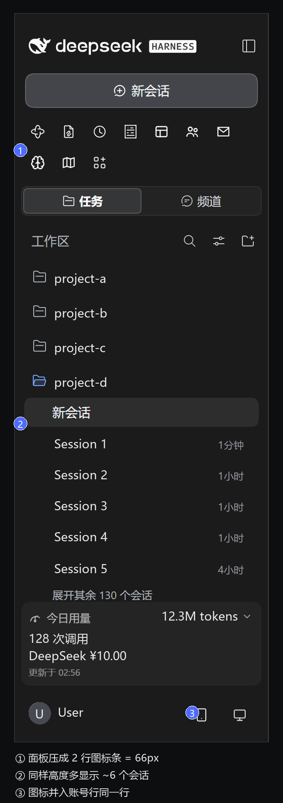
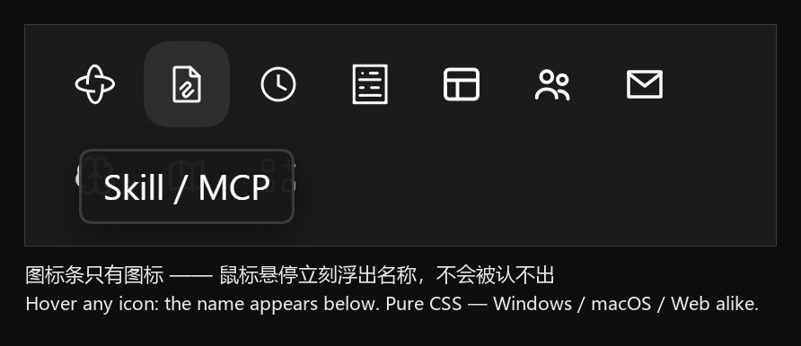

<div align="center">

<h1>🗂️ Tight Sidebar · 紧凑侧边栏</h1>

<p>
<b>🌐 语言 / Language</b><br>
<a href="README.en.md"></a> <a href="README.md"></a><br>
<sub>Current: English　·　切换到简体中文 →</sub></p>

<p>
<a href="LICENSE"></a>
<a href="CHANGELOG.en.md"></a>
<a href="#-how-it-works"></a>
<a href="#-install"></a>
<a href="CHANGELOG.en.md"></a>
</p>

<p><b>A pure-CSS sidebar density skin for DeepSeek Harness</b><br>
No color changes, no materials, no fonts — it only collapses the one-control-per-row layout and gives the vertical space back to the session list you actually read.</p>

</div>

> ### 🎯 Give the sidebar's vertical space back to Workspace
>
> **That is the original motivation behind this skin — and its only acceptance test.**
>
> Controls keep piling up at the top of the sidebar — panels, plugin entries, usage cards, remote-control icons… and every one of them eats into the Workspace session list below.
> This project does exactly one thing: **make Workspace grow again.** Every rule here serves that goal; anything that doesn't is left out.

<table>
<tr>
<td width="50%" valign="top"><br><sub><b>Before</b> · ten panel rows eat ~740px, the session list is pushed out of sight</sub></td>
<td width="50%" valign="top"><br><sub><b>After</b> · panels collapse to a 66px icon strip; ~6 more sessions fit, icons merged into the account row</sub></td>
</tr>
</table>

> Both images are real UI screenshots; nickname, workspace names, session titles and usage figures were replaced with placeholders.

### 🏷 Icons without labels — but never unidentifiable

The question everyone asks about the icon strip: won't I lose track of which icon is which? No. Hover any icon and its name pops up right below it — you still read icon *and* name:



- The tooltip is **pure CSS** (`:hover` / `:focus-visible`) — no plugin, no `title` attribute, identical on Windows, macOS and the web;
- It appears on **keyboard focus (`Tab`)** too, not only on mouse hover;
- The label is the panel's original title, merely moved into an overlay — nothing was deleted.

---

## ✨ What it does

More conversations on the same screen:

| Section | What | Saved |
| --- | --- | :--: |
| 🧱 **Panel list** | Plugins / Memory / Task board … from a vertical list to a single row of `32×32` tiles — **text is not lost** (tooltip on hover) | ~110px |
| 📞 **Footer actions** | Remote-control, update, phone icons move next to the account row; the reserved space adapts to the number of icons | ~80px |
| 🩹 **Leftover band** | The absolutely-positioned buttons leave a 36px empty box behind → height set to zero | 36px |
| 📏 **Session rail** | Drops `.ima-rail { min-height:180px }`, no more half-cut rows | — |

> Measured on a 280px × 700px sidebar: **~190–230px reclaimed, 6+ extra conversations visible**.

## 📐 How it works

The skin center uses three layers; this skin only touches the outermost one:

| Layer | File | Contents |
| :--: | --- | --- |
| L1 / L2 | `skin.css` | **Deliberately empty** — one lazy variable `--dsh-tight-sidebar:1`. No `--dsw-*` design tokens are remapped, so colors, radii, wallpaper translucency and fonts stay stock |
| L3 | `patches.css` | All the changes live here (free-selector layer) |

Every rule is prefixed with `body:not(:has([data-sidebar-collapsed]))` — **the collapsed rail keeps the stock layout**.

## 🚀 Install

Requires the skin-center plugin `@linxin666/dsh-client-ui-skin-center` (it provides the `~/.dsh/skins` directory and the L3 patch channel).

```bash
# 1️⃣ Copy the three files into the user skin directory
#    macOS:   ~/.dsh/skins/tight-sidebar/
#    Windows: %USERPROFILE%\.dsh\skins\tight-sidebar\

mkdir -p ~/.dsh/skins/tight-sidebar
cp skin/skin.json skin/skin.css skin/patches.css ~/.dsh/skins/tight-sidebar/
```

```text
2️⃣ Enable it (either way)
   · Settings → Skin Center → Tight Sidebar → Apply / Try on
   · or write ~/.dsh/skin-center-active.json
     {"active":"tight-sidebar","initialized":true}
```

```text
3️⃣ Reopen DSH
   · Desktop build has no reload shortcut → quit and relaunch
   · In the Web GUI, ⌘R / F5 is enough
```

**Rollback**: switch back to "Official default" in Skin Center, set `active` to `null`, or delete `~/.dsh/skins/tight-sidebar/`.

## 🔧 A concrete example: that 36px band

Once the footer icons are pinned to the right of the account row with `position:absolute`, they leave the flow — but their container stays in the flow holding a 36px empty box.


> Left: the action icons take a whole row of their own and the account row is squeezed down to a bare avatar. Right: the icons sit at the right edge of the account row — one whole row saved.

**Rule of thumb: the icons moved out, so demolish the old house.** One `height:0` fixes it; `overflow` must stay `visible` or the pinned icons get clipped.

## ⚠️ Known risks

1. 🎯 **Semantic class names, not a stable API.** Selectors match substrings like `[class*="panelList"]`, `[class*="footArea"]`, `[class*="settingsArea"]` (official builds add a hash prefix, e.g. `bJOniG_footArea`). If a host upgrade renames them, the rules **fail silently** — no error, no wrong element styled, it just looks like the skin stopped working.
2. 📌 **The footer part relies on absolute positioning.** It needs `footArea / footerActions / settingsArea` to exist. It is the only way to move icons into the account row without touching the host DOM (see the 10 rejected versions in the CHANGELOG).
3. 🩹 **The `§2f` height reset is not optional.**
4. 🧪 **Only verified on DSH NEXT 2.x (Windows / macOS).** The Web GUI shares the same renderer code.
5. 🔍 **Do not guess the DOM.** Open the Web GUI in a browser (`http://127.0.0.1:<port>/?token=…`) and measure real bounding boxes.

## 📜 Versions & lessons

**21 numbered iterations, 10 of them rejected**: two-column grid, `display:contents` flattening, specificity tiers, index-based positioning, flex re-flow — nearly every dead end was walked.

Why each one failed is documented in **[CHANGELOG.en.md](CHANGELOG.en.md)** — that part is more useful than the final file.

| Milestone | Note |
| :--: | --- |
| v1 | macOS port (two-column panels) |
| v7 | Footer icons successfully merged into the account row ✅ |
| v15 | Stable baseline: icon bar + v7 footer ✅ |
| v21 | Adaptive reserved space + 36px band removed ✅ **current** |

## 🧩 Tuning it for your build

| Want | Change |
| --- | --- |
| Tiles per row in the panel list | `width` / `height` / `min-height` of `panelRow` (all three) and `gap` of `panelList` |
| Footer icon size / edge offset | `36px` in `§2c`, `6px` in `§2b` / `§2e` |
| How much the account row yields | the 50 / 92 / 134 / 176 / 218px ladder in `§2e` (+42px per extra icon) |

Capacity formula: `n · T + (n − 1) · G ≤ W` (n icons, size T, gap G, available width W).

## 📄 License

[](LICENSE) · Use it, fork it, break it — no warranty 😄

<div align="center"><sub>🇨🇳 <a href="README.md">用中文阅读</a></sub></div>
