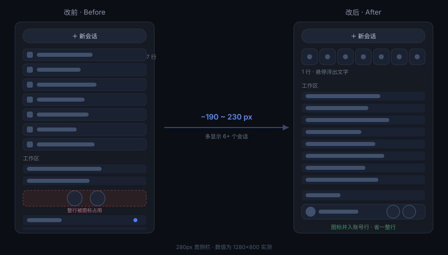
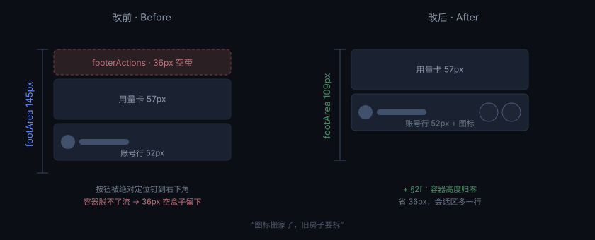

<div align="center">

<h1>🗂️ 紧凑侧边栏 · Tight Sidebar</h1>

<p>
<b>🌐 语言 / Language</b><br>
<a href="README.md"></a> <a href="README.en.md"></a><br>
<sub>当前：简体中文　·　Switch to English →</sub></p>

<p>
<a href="LICENSE"></a>
<a href="CHANGELOG.md"></a>
<a href="#-三段式原理"></a>
<a href="#-安装"></a>
<a href="CHANGELOG.md"></a>
</p>

<p><b>给 DeepSeek Harness 用的纯 CSS 侧边栏排版皮肤</b><br>
不改配色、不换材质、不动字体 —— 只把「一行一个」的控件收拢，把纵向空间还给真正要看的「工作区」会话列表。</p>

</div>



---

## ✨ 效果

同一块屏幕，能看到的会话更多：

| 段落 | 做什么 | 省下 |
| --- | --- | :--: |
| 🧱 **全局面板** | 插件 / 记忆 / 任务看板 … 从竖排列表收成 `32×32` 方块横排，**文字不丢**（悬停浮出气泡） | ~110px |
| 📞 **页脚动作** | 远程控制、更新、电话等图标并到账号行右侧，让位随图标颗数自适应 | ~80px |
| 🩹 **遗留空带** | 绝对定位的按钮走了，容器还在流里占 36px → 高度归零 | 36px |
| 📏 **会话轨** | 去掉 `.ima-rail` 的 `min-height:180px`，不再把会话行裁半截 | — |

> 280px 宽、700px 高的侧栏实测：**省出约 190–230px，多显示 6 个以上会话**。

## 📐 三段式原理

皮肤中心是三层结构，这套皮肤**只在最外层动手**：

| 层 | 文件 | 内容 |
| :--: | --- | --- |
| L1 / L2 | `skin.css` | **刻意留空**，只放一个惰性变量 `--dsh-tight-sidebar:1`。不重映射任何 `--dsw-*` 设计令牌 → 配色、圆角、壁纸穿透、字体全部沿用官方 |
| L3 | `patches.css` | 全部改动都在这里（自由选择器层），可写任意 `body:not(:has(...)) ...` 规则 |

所以它**只改排版**：你换主题、换壁纸、改字号，它都不会打架。

所有规则统一带 `body:not(:has([data-sidebar-collapsed]))` 前置 —— **侧栏收起时保持官方布局**，不去猜收起态的形状。

## 🚀 安装

需要 DSH 已装皮肤中心插件 `@linxin666/dsh-client-ui-skin-center`（它提供 `~/.dsh/skins` 目录与 L3 补丁通道）。

```bash
# 1️⃣ 三个文件放进用户皮肤目录
#    macOS:   ~/.dsh/skins/tight-sidebar/
#    Windows: %USERPROFILE%\.dsh\skins\tight-sidebar\

mkdir -p ~/.dsh/skins/tight-sidebar
cp skin/skin.json skin/skin.css skin/patches.css ~/.dsh/skins/tight-sidebar/
```

```text
2️⃣ 启用（二选一）
   · 设置 → 皮肤中心 → 紧凑侧边栏 → 使用 / 试穿
   · 或直接写激活文件 ~/.dsh/skin-center-active.json
     {"active":"tight-sidebar","initialized":true}
```

```text
3️⃣ 重开 DSH
   · 桌面端没有页面刷新快捷键 → 彻底退出再打开
   · Web GUI 里 ⌘R / F5 即可
```

**回滚**：皮肤中心切回「官方默认」／把 `skin-center-active.json` 的 `active` 改回 `null`／删掉 `~/.dsh/skins/tight-sidebar/`。

## 🔧 一个具体例子：页脚那 36px

页脚图标被绝对定位钉到账号行右侧后，按钮脱离了文档流 —— 但它的容器还留在流里，保留着 36px 的空盒子。



**口诀：图标搬家了，旧房子要拆。** 补一条 `height:0` 就够，`overflow` 必须留 `visible`（否则把钉住的图标裁掉）。

## ⚠️ 已知风险

1. 🎯 **靠语义类名，不靠稳定 API。** 选择器匹配 `[class*="panelList"]`、`[class*="footArea"]`、`[class*="settingsArea"]` 这类子串（官方构建会给类名加哈希前缀，如 `bJOniG_footArea`）。宿主升级后若改了这些词，规则**静默失效**：不报错、也不会套错元素，表现就是「皮肤好像没生效」。
2. 📌 **页脚那段是绝对定位方案。** 依赖 `footArea / footerActions / settingsArea` 三个容器同时存在，是唯一能不改宿主 DOM 就让图标进账号行的办法（代价见 CHANGELOG 里被推翻的 10 个版本）。
3. 🩹 **`§2f` 的高度归零不可省。** 见上一节，否则页脚永远多一条 36px 空带。
4. 🧪 **只在 DSH NEXT 2.x（Windows / macOS）验证过。** Web GUI 与桌面端共用同一套渲染代码。
5. 🔍 **调样式时别只靠肉眼。** 用浏览器打开 Web GUI（`http://127.0.0.1:<端口>/?token=…`）后，元素盒子的坐标可以直接量出来，比猜 DOM 可靠得多。

## 📜 版本与教训

一共 **21 个编号版本**，其中 **10 个是被推翻的尝试**：网格两列、`display:contents` 摊平、特异性分层、按序号定位、flex 重排…… 几乎每条死路都走过。

每个版本为什么失败、教训是什么，全写在 **[CHANGELOG.md](CHANGELOG.md)** —— 那部分比成品更有用。

| 里程碑 | 说明 |
| :--: | --- |
| v1 | macOS 移植初版（面板两列） |
| v7 | 页脚图标首次成功并入账号行 ✅ |
| v15 | 稳定基线：面板图标条 + v7 页脚 ✅ |
| v21 | 让位自适应 + 清掉 36px 空带 ✅ **当前** |

## 🧩 适配自己的版本

宿主改版或你的屏幕更窄/更宽时，只需要调几个数：

| 想要 | 改哪 |
| --- | --- |
| 面板一行放几个图标 | `panelRow` 的 `width` / `height` / `min-height`（三处必须同改）与 `panelList` 的 `gap` |
| 页脚图标大小与贴边距离 | `§2c` 的 `36px` 与 `§2b/§2e` 的 `6px` |
| 账号行为图标让出多少 | `§2e` 的 50 / 92 / 134 / 176 / 218px 阶梯（每多一颗 +42px） |

容量公式：`n · T + (n − 1) · G ≤ W`（n 个图标、单个 T、间隙 G、可用宽度 W）。

## 📄 License

[](LICENSE) · 随便用、随便改，出问题别找我 😄

<div align="center"><sub>🌐 <a href="README.en.md">Read this in English</a></sub></div>
